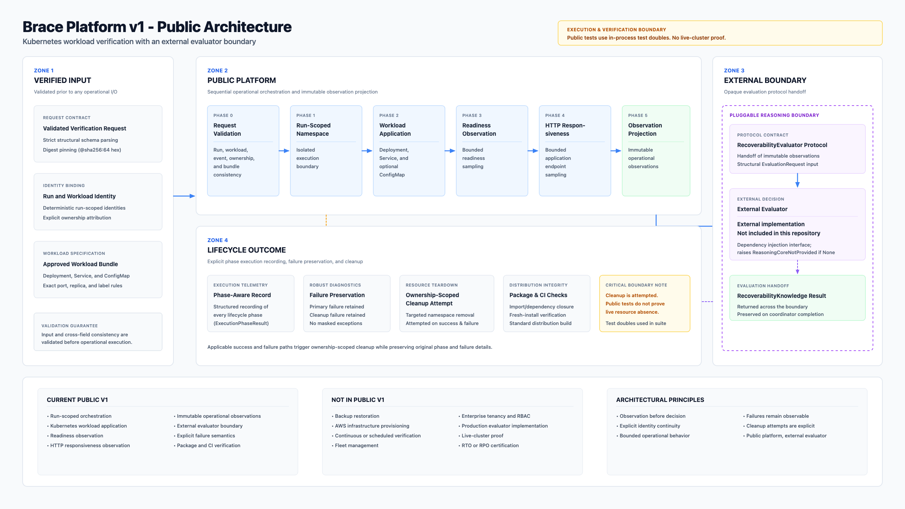

# Brace Platform

[](https://github.com/ganeshvm-blr/brace-platform/actions/workflows/ci.yml)

Brace Platform orchestrates isolated Kubernetes verification runs to observe application workloads and deliver structured evidence across a pluggable decision boundary.

In disaster recovery and platform operations, teams often confirm that Kubernetes resources were applied successfully without verifying that the application became ready and responsive. Declaring an environment recoverable based solely on manifest creation leaves operational gaps when workloads crash, fail health probes, or experience connectivity failures.

This public package addresses that problem by orchestrating a bounded verification run: it creates a run-scoped namespace, applies an approved workload bundle (Deployment, Service, and ConfigMap), observes Kubernetes readiness within bounded deadlines, probes HTTP responsiveness, projects results into immutable operational observations, delegates evaluation to an external `RecoverabilityEvaluator`, and attempts ownership-scoped cleanup.

This repository focuses on workload orchestration, observation, and boundary contracts. It does not restore backups, manage volume snapshots, or recover storage systems, and it does not contain the proprietary evaluator decision implementation.

## Current Public V1

The current public baseline demonstrates:

- validated, run-scoped verification requests;
- isolated namespace orchestration;
- approved Kubernetes workload application;
- bounded readiness and HTTP responsiveness observations;
- immutable operational observation projection;
- delegation through an external RecoverabilityEvaluator protocol;
- ownership-scoped cleanup attempts;
- explicit primary and cleanup failure preservation;
- tested package and distribution boundaries.

This public V1 is an orchestration and observation platform. It does not restore backups, provision AWS infrastructure, include the production evaluator, or prove live-cluster recoverability.

See [docs/public-roadmap.md](docs/public-roadmap.md) for high-level capability directions that are intentionally separated from implementation commitments.

## Public Architecture



The diagram is limited to capabilities present in the public package. See [Architecture](docs/architecture.md) for component-level detail and the [Verification matrix](docs/verification-matrix.md) for the evidence and limitations behind each claim.

*Public package boundary. The production evaluator and backup restoration mechanisms are not included.*

## What the public repository demonstrates

- **Workload application and observation, not backup restoration** — the platform applies and observes an approved workload bundle (Deployment, Service, ConfigMap); it does not implement backup restoration, volume snapshots, or storage recovery.
- **Run-scoped namespace identity and ownership** — every run derives a deterministic namespace identity from its run id and carries explicit ownership metadata.
- **Isolated namespace lifecycle** — namespaces are created for a run and removed by ownership-scoped cleanup.
- **Approved workload-bundle validation** — the request parser accepts only an approved bundle shape with strict cross-field checks.
- **Digest-pinned container images** — images must be pinned with `@sha256:` followed by exactly 64 hexadecimal characters.
- **Workload application and inspection** — deployments, services, and config maps are applied and reinspected for exact-match confirmation.
- **Readiness observation** — Kubernetes readiness is observed against a bounded convergence deadline.
- **Application-responsiveness observation** — in-cluster service responsiveness is observed with bounded retry and timeout policy.
- **Phase execution success vs observation outcome** — operational phase success records that a lifecycle phase completed without infrastructure crash; it is distinct from whether an observation check observed an affirmative or negative condition.
- **Convergence, retry, timeout, and transport policy** — a shared convergence engine implements deadline-bounded sampling, retryable transient classification, and timeout handling.
- **Deterministic observation identity** — every projected observation is identified deterministically from run, event, workload, and evidence-kind references.
- **Immutable evidence records** — observations are frozen dataclasses; `EvidenceKind` is an exact two-member enumeration.
- **Opaque evaluator dependency injection** — the coordinator depends only on the `RecoverabilityEvaluator` protocol; no decision logic lives in the platform.
- **Phase-aware failure handling** — every operational phase failure is recorded with its phase and original exception.
- **Cleanup after operational or boundary failures** — ownership-scoped cleanup is attempted after applicable failures.
- **Explicit cleanup failure after successful evaluation** — a successful evaluation followed by a cleanup failure raises `VerificationCleanupFailed` while preserving the produced result.
- **In-process authority-chain tests** — the test suite exercises the full coordination chain through in-process fakes; these unit/integration tests do not constitute live-cluster proof.

## Architecture boundary

```
Kubernetes execution and observation
    -> immutable operational observations
    -> RecoverabilityEvaluator protocol
    -> RecoverabilityKnowledge
```

The direction of dependence is one-way:

- the platform executes and observes infrastructure;
- the evaluator decides recoverability;
- the evaluator implementation is not included in this repository;
- an `evaluator=None` run reaches `ReasoningCoreNotProvided` through the real boundary at the `reasoning_boundary` phase;
- no fallback or demonstration reasoning algorithm is supplied.

The internal decision procedure of an evaluator — how a conclusion is derived from the observations it receives — is external to this repository and is not part of the public contract.

## Runtime lifecycle

A verification run proceeds through the exact public operational phases:

| Phase | Value | Meaning |
|---|---|---|
| `NAMESPACE_CREATE` | `namespace_create` | create the run-scoped namespace with ownership |
| `WORKLOAD_APPLY` | `workload_apply` | apply the approved workload bundle |
| `READINESS_OBSERVE` | `readiness_observe` | observe Kubernetes readiness within a bounded deadline |
| `RESPONSIVENESS_OBSERVE` | `responsiveness_observe` | observe service responsiveness with retry and timeout policy |
| `OBSERVATION_PROJECT` | `observation_project` | project operational results into immutable observations |
| `REASONING_BOUNDARY` | `reasoning_boundary` | hand observations across the boundary to the evaluator |
| `NAMESPACE_CLEANUP` | `namespace_cleanup` | remove the run-scoped namespace under ownership |

These are operational lifecycle phases of the platform, not reasoning stages of an evaluator.

## Failure semantics

Verified public behavior:

- a primary operational or boundary failure raises `VerificationCoordinationFailed` with the failed phase and the original exception;
- when cleanup after a failure also fails, the cleanup exception is retained separately on `cleanup_failure`;
- cleanup is attempted after applicable failures;
- a successful evaluation followed by a cleanup failure raises `VerificationCleanupFailed`, preserving the produced knowledge, observations, and phase record;
- evaluator absence surfaces as `ReasoningCoreNotProvided` inside `VerificationCoordinationFailed` at the `reasoning_boundary` phase.

## Explore the Engineering

- [Five-minute walkthrough](docs/demo.md): follow orchestration, boundary
  validation, failure handling, and cleanup through executable tests.
- [Verification matrix](docs/verification-matrix.md): map public claims to
  evidence and understand their limits.
- [AWS deployment case study](docs/aws-case-study.md): review a sanitized,
  high-level deployment context and its separation from the public package.
- [Architecture](docs/architecture.md): review component responsibilities
  and the external evaluator boundary.
- [Public capability roadmap](docs/public-roadmap.md): review the capability
  horizons and the product boundaries that keep Brace focused.

The walkthrough uses in-process test doubles. It does not restore a backup,
contact a live cluster, or include a recoverability decision algorithm.

## Installation

The package metadata requires Python >= 3.10.

```powershell
python -m venv .venv
.\.venv\Scripts\Activate.ps1
python -m pip install --upgrade pip
python -m pip install -e ".[dev]"
```

## Verification

```powershell
python -m pytest tests -v -p no:cacheprovider
```

Current verified local result: **39 tests passed on Python 3.14.6**.

The public audit also verified packaging with:

```powershell
python -m build
```

This builds both wheel and source distribution; the audit confirmed their contents (no tests, no generated artifacts, no private references). Building distributions is not required to run the test suite.

## Public-package limits

- **Workload observation vs backup restoration**: The public implementation applies and observes a synthetic workload bundle; it does not implement backup restoration, volume snapshots, or database recovery.
- **In-process fakes vs live clusters**: The public test suite runs entirely in-process against test doubles; it does not constitute live-cluster proof.
- **Phase success vs observation outcome**: An operational phase recording success indicates only that the lifecycle step ran without infrastructure failure; it does not mean an affirmative observation or positive recoverability judgment was established.
- **Cluster configuration**: Kubernetes external interactions require suitable runtime configuration (credentials and cluster access are intentionally not part of this repository).
- **Evaluator boundary**: Reaching an authoritative recoverability conclusion requires an injected `RecoverabilityEvaluator`. The proprietary evaluator is intentionally not distributed.

## Repository structure

```
src/brace/                 public platform package (src layout)
src/brace/reasoning/       the public reasoning boundary contract
tests/                     verification and packaging guard tests
pyproject.toml             package metadata and tool configuration
MANIFEST.in                source-distribution file selection
```

## Engineering highlights

- **Deterministic identity** — namespaces and observations derive identities from run, event, and workload references.
- **Immutable models** — frozen dataclasses and exact enumerations throughout the evidence path.
- **Strict cross-field validation** — mismatched run, event, workload, ownership, bundle, port, replica, and digest references are rejected before any I/O.
- **Dependency inversion** — the coordinator depends on adapter protocols and the evaluator protocol, not concrete infrastructure or decision logic.
- **Ownership-safe cleanup** — deletion is scoped by ownership and run identity.
- **Executable failure-path verification** — every phase failure path and both cleanup failure modes are covered by tests.
- **Dependency-closed package** — a packaging guard proves declared runtime dependencies exactly match retained-module imports.

## Interview walkthrough

1. `_runtime_owned_request.py` — how an approved request is validated with strict cross-field invariants before any I/O.
2. `_runtime_owned_composition.py` — the public entry point that wires adapters, observers, transport, and the optional evaluator into one coordinator.
3. `_runtime_owned_verification.py` — the coordinator: exact phase sequencing, phase recording, boundary handoff, and cleanup semantics.
4. `_operational_projection.py` — how operational check results are deterministically projected into immutable evidence records.
5. `reasoning/boundary.py` — the one-directional contract between platform and evaluator, and what it deliberately does not expose.
6. `tests/test_runtime_owned_composition.py` — composition-level tests including the real boundary path with and without an evaluator.
7. `tests/test_runtime_owned_verification.py` — the authority-chain and failure-path tests with production-valid fakes.

## Status

This repository is a public platform implementation with an intentionally external reasoning component. No roadmap or unreleased features are listed here.
