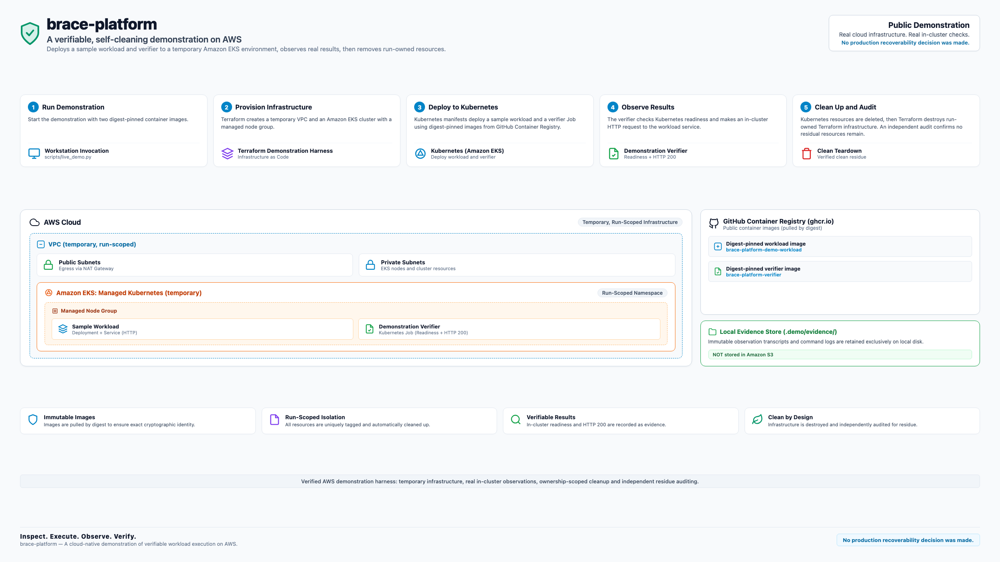
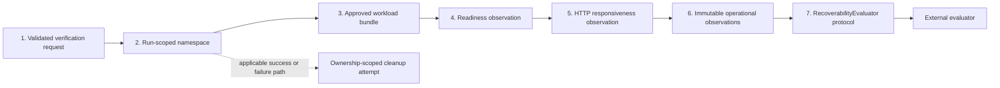
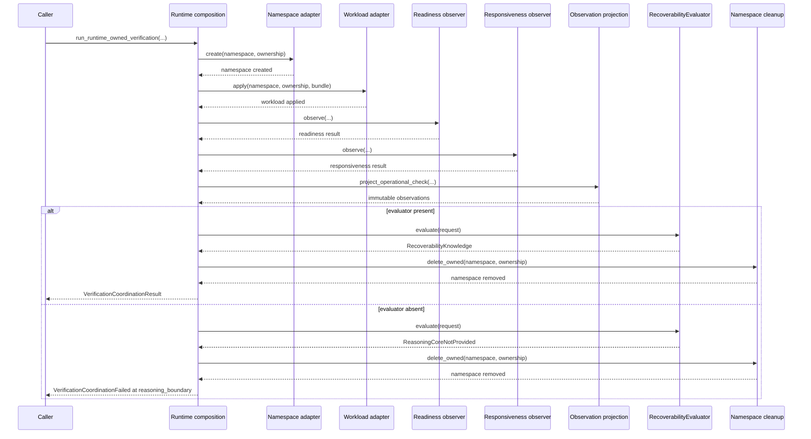
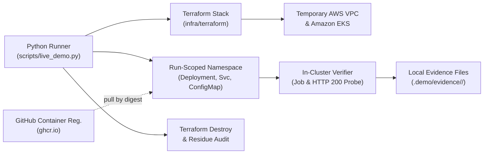

# Brace Platform Architecture

## 1. Scope and Purpose

This document specifies the technical architecture of Brace Platform across two distinct layers:
1. **Layer A — Product and Package Architecture**: The installable Python package (`brace`) orchestrating request validation, run-scoped namespace lifecycles, workload deployment, bounded operational observation, immutable evidence projection, and boundary delegation across the `RecoverabilityEvaluator` protocol.
2. **Layer B — Verified AWS Demonstration Architecture**: The standalone demonstration harness (`scripts/live_demo.py` and `infra/terraform`) orchestrating temporary Amazon Web Services (AWS) infrastructure, Amazon Elastic Kubernetes Service (EKS), in-cluster observation, structured local evidence, and teardown with residue verification.

The platform's operational responsibility ends where decision making begins. Brace Platform executes and observes infrastructure and workloads; it does not decide recoverability. The evaluator implementation is external by design and is not included in this repository. Neither layer implements backup restoration or contains the production evaluator.

## Visual Architecture Guide

The architecture and demonstration surfaces of Brace Platform are documented across three complementary visual models:

### 1. Two-Path Overview: Product and Demonstration Boundaries

The high-level boundary model separating the verified AWS demonstration harness from the local package demonstration using in-process test doubles.


*Brace Platform demonstration overview showing the verified AWS demonstration harness (top lane) and the local package demonstration using in-process test doubles (bottom lane). Source definition maintained in [brace-platform-two-path-overview-source.md](assets/brace-platform-two-path-overview-source.md).*

### 2. AWS Demonstration Lifecycle: Live Execution Path

The self-cleaning five-stage execution path of the standalone AWS demonstration harness across temporary VPC, Amazon EKS, in-cluster verification, and residue audit.



*Verified AWS demonstration harness: temporary infrastructure, real in-cluster observations, ownership-scoped cleanup and independent residue auditing. Source definition maintained in [brace-platform-aws-lifecycle-source.md](assets/brace-platform-aws-lifecycle-source.md).*

### 3. Detailed Architecture: Component-Level Reference

The detailed structural component and protocol wiring diagram across both demonstration surfaces.


*Architectural reference detailing component wiring, observation models, and boundary contracts for both demonstration paths. Source definition maintained in [brace-platform-architecture-source.md](assets/brace-platform-architecture-source.md).*

```
Kubernetes execution and observation
    -> immutable operational observations
    -> RecoverabilityEvaluator protocol
    -> RecoverabilityKnowledge
```

The system enforces a strict one-way dependency boundary:
- The **platform** creates and removes run-scoped namespaces, applies approved workload bundles, observes readiness and responsiveness, and projects immutable observations. It never decides recoverability.
- The **evaluator** receives one boundary request per run and returns an immutable `RecoverabilityKnowledge` result. It never operates infrastructure.
- When no evaluator is injected (`evaluator=None`), the platform executes every operational phase and fails at the boundary with `ReasoningCoreNotProvided`, followed by ownership-scoped cleanup.
- *No production recoverability decision was made.*

---

## 2. Layer A: Product and Package Architecture

The installable Python package (`src/brace/`) provides modular, protocol-driven orchestration components designed to execute against any conformant Kubernetes cluster:



### Component Responsibilities

| Component | Module | Responsibility |
|---|---|---|
| **Request validation** | `_runtime_owned_request.py` | Parse and strictly validate the approved run request: identities, ownership, bundle shape, port alignment, replica count, and image digest pinning before any I/O. |
| **Namespace adapter** | `_kubernetes_namespace.py` | Create, inspect, and ownership-scoped deletion of the run-scoped namespace using `kubernetes.client.CoreV1Api`. |
| **Workload adapter** | `_kubernetes_workload.py` | Apply the approved Deployment, Service, and ConfigMap manifests; reinspect applied resources for exact-match confirmation. |
| **Readiness observer** | `_kubernetes_readiness.py` | Sample Kubernetes deployment ready condition within a bounded convergence deadline. |
| **Responsiveness observer** | `_kubernetes_responsiveness.py` | Sample in-cluster service endpoints over the transport with bounded retry and timeout policy. |
| **Convergence engine** | `_runtime_observation_convergence.py` | Shared deadline-bounded sampling, retryable transient classification, and timeout handling. |
| **Transport** | `_http_client_transport.py` | Minimal stdlib HTTP transport with strict error classification for responsiveness observation. |
| **Projection** | `_operational_projection.py` | Deterministically project operational check results into immutable evidence records. |
| **Coordinator** | `_runtime_owned_verification.py` | Sequence the exact public phases, record phase execution results, perform the boundary handoff, and enforce cleanup semantics. |
| **Composition** | `_runtime_owned_composition.py` | Factory wiring adapters, observers, transport, clocks, and timeouts into a cohesive coordinator. |
| **Boundary** | `reasoning/boundary.py` | Defines the `RecoverabilityEvaluator` protocol, the structural `EvaluationRequest` contract, and the `ReasoningCoreNotProvided` exception. |
| **Evidence models** | `_evidence_kind.py`, `_recovery_observation.py`, `_recoverability_knowledge.py` | Immutable value types flowing from the platform across the decision boundary. |

### Seven-Phase Runtime Lifecycle

A verification run executes the following exact operational phases in order:

1. `namespace_create` — the namespace adapter creates the run-scoped namespace with explicit ownership metadata.
2. `workload_apply` — the workload adapter applies the approved bundle (Deployment, Service, ConfigMap).
3. `readiness_observe` — the readiness observer samples Kubernetes readiness until converged or timed out.
4. `responsiveness_observe` — the responsiveness observer samples the service endpoint until successful or timed out.
5. `observation_project` — the projection function converts operational results into immutable evidence records.
6. `reasoning_boundary` — the coordinator constructs the boundary request and delegates across the protocol.
7. `namespace_cleanup` — the namespace adapter removes the run-scoped namespace under ownership labels.

Every phase records an `ExecutionPhaseResult` with a `succeeded` flag. An operational phase recording `succeeded=True` indicates that the lifecycle step ran without infrastructure failure; it is distinct from whether the observed check condition evaluated to an affirmative or negative result.



### Identity and Ownership Invariants

The platform enforces strict structural continuity before any operational I/O:
- `recovery_event.workload_id == protected_workload.workload_id`
- `namespace.run_id == run_id`
- `ownership.run_id == run_id`
- `ownership.workload_id == protected_workload.workload_id`
- `ownership.bundle == workload_bundle.identity`
- `service.target_port == deployment.container.container_port`
- `replicas == 1`
- Container images require `@sha256:` followed by exactly 64 hexadecimal characters.

Immediately upon receiving a response from the evaluator, the coordinator additionally validates:
- The return value is an instance of `RecoverabilityKnowledge`.
- `knowledge.subject.subject_id.value == protected_workload.workload_id`.

If these invariants are violated, the coordinator rejects the return object, triggers ownership-scoped cleanup, and raises `TypeError` or `ValueError`.

### Deterministic Observation Projection

The projection function `project_operational_check(run_id, protected_workload, recovery_event, result)` converts operational check results into immutable frozen dataclass instances with:
- An evidence kind derived deterministically from the check kind:
  - `KUBERNETES_READY` -> `EvidenceKind.KUBERNETES_READINESS`
  - `APPLICATION_RESPONSIVE` -> `EvidenceKind.APPLICATION_RESPONSIVENESS`
- Deterministic record identities derived from `run_id`, `recovery_event_id`, `workload_id`, and `evidence_kind`.
- Verbatim propagation of event and workload references.

### Failure and Cleanup Model

1. **Phase failure**: An unhandled exception during any operational phase records the failure and raises `VerificationCoordinationFailed` with `failed_phase`, `primary_failure`, `cleanup_failure`, and the phase record.
2. **Post-failure cleanup**: Ownership-scoped namespace deletion is attempted after any phase failure. If cleanup also fails, the cleanup exception is stored separately on `cleanup_failure`; the primary failure is never masked.
3. **Post-success cleanup failure**: If evaluation succeeds but subsequent namespace deletion fails, `VerificationCleanupFailed` is raised, preserving both the cleanup exception and the generated `RecoverabilityKnowledge`.
4. **Missing evaluator**: When no evaluator is injected, the platform completes phases 1–5, raises `ReasoningCoreNotProvided` at phase 6 (`reasoning_boundary`), and attempts namespace deletion.

---

## 3. Layer B: Verified AWS Demonstration Architecture

The repository contains a standalone, explicitly invoked demonstration harness designed to validate the orchestration model against live AWS infrastructure without proprietary dependencies:



### AWS Demonstration Components

1. **Python Lifecycle Runner (`scripts/live_demo.py`)**:
   A dedicated orchestration script managing prerequisites, node eligibility checks, Terraform convergence, kubeconfig generation, manifest rendering, in-cluster Job dispatch, result validation, teardown, and residue verification.
2. **Terraform Stack (`infra/terraform`)**:
   Provisions temporary, run-isolated infrastructure:
   - AWS VPC with CIDR `10.0.0.0/16`.
   - 2 Public Subnets (`10.0.101.0/24`, `10.0.102.0/24`) and 2 Private Subnets (`10.0.1.0/24`, `10.0.2.0/24`).
   - Single NAT Gateway for outbound container pulling.
   - Amazon EKS Control Plane (Kubernetes 1.36).
   - Managed Node Group configured with 1x `t3.small` instance (`FreeTierEligible=true`, `x86_64`).
   - Explicit 2700-second apply timeout.
3. **Approved Workload Bundle**:
   Located in `workloads/demo-app/`, containing Deployment, Service, and ConfigMap definitions applied into a run-scoped namespace (`run-<id>`) with explicit ownership labels (`brace.platform/run-id`, `brace.platform/ownership-owner`).
4. **GitHub Container Registry (GHCR)**:
   Container images are pulled directly from GHCR by the EKS nodes; Amazon ECR is **not** used:
   - Workload: `ghcr.io/ganeshvm-blr/brace-platform-demo-workload@sha256:588c07b235103a9f73d5f069418c1b1e2966c57245fd4be4bab8658053a5650a`
   - Verifier: `ghcr.io/ganeshvm-blr/brace-platform-verifier@sha256:d06d70a5b892705ad537f05eb246d8171cc236d52310912b800789bc84509fc8`
5. **Real In-Cluster Observation**:
   - Readiness: The runner polls the Kubernetes API until the deployment achieves `availableReplicas == 1`.
   - Responsiveness: An in-cluster verifier Job launches inside the run namespace, probes the Service's cluster IP, and observes HTTP status `200 OK`.
6. **Local Evidence Retention**:
   All execution transcripts, timestamps, and structured results are stored exclusively on local disk at `.demo/evidence/<run-id>/` (`summary.json`, `summary.md`, and `verifier-result.json`). Evidence is **not** uploaded to Amazon S3.
7. **Clean Teardown and Residue Audit**:
   - The runner removes the run-scoped namespace, RBAC roles, and verifier Job.
   - A pre-destroy node group guard ensures node groups are cleanly detached before cluster deletion.
   - `terraform destroy` cleanly removes all 22 cloud resources.
   - An independent AWS CLI audit checks for surviving VPCs, subnets, NAT gateways, route tables, security groups, and EKS clusters, confirming zero active run-owned resources.

### Verified Milestone Facts

The live demonstration was validated end-to-end on AWS on commit `e8329b6` with Run ID `895844a6-afb2-45e1-a2c6-30c1229dc844` in region `ap-south-1`. See [docs/public-demo-freeze.md](public-demo-freeze.md) for the verified freeze record.

---

## 4. Evaluator Boundary Inversion

`src/brace/reasoning/boundary.py` establishes the contract between platform execution and external evaluation:
- `RecoverabilityEvaluator`: A runtime-checkable protocol with a single method: `evaluate(request: EvaluationRequest) -> RecoverabilityKnowledge`.
- `EvaluationRequest`: Structural envelope containing run ID, protected workload, recovery event, and projected immutable observations.
- `evaluate_recoverability`: The boundary dispatch function. If an evaluator is provided, it delegates; if omitted, it raises `ReasoningCoreNotProvided`.
- `RecoverabilityKnowledge`: An immutable value type carrying the evaluator's findings and subject reference.

The platform holds no reference to evaluator heuristics, rules, scoring algorithms, or decision pipelines. In both the local package demo (`python -m brace.demo`) and the live AWS demo, an illustrative demonstration test double returning fixed affirmed standing is supplied. *No production recoverability decision was made.*

---

## 5. Security and Supply Chain Posture

- **Cryptographic Digest Pinning**: All container image references must be pinned with `@sha256:` followed by 64 hexadecimal characters. Requests with tag-based images (`:latest`) are rejected before any I/O.
- **Ownership-Scoped Cleanup**: Resource deletion queries filter strictly by ownership labels to prevent accidental deletion of unrelated infrastructure.
- **Zero Credentials**: No credentials, access keys, tokens, or environment-specific paths are tracked in the repository. Packaging audits scan all distributions for credential patterns.
- **Dependency Closure**: The package declares only `kubernetes` and `urllib3` as runtime dependencies, matching retained imports exactly.

---

## 6. What Is Intentionally External

The following capabilities are explicitly outside the scope of Brace Platform:
- **No Backup Restoration**: The platform applies and observes workloads; it does not implement backup restoration.
- **No Production Evaluator**: The proprietary decision engine that evaluates operational evidence against recovery standards is external.
- **No Amazon ECR**: The demonstration harness uses GitHub Container Registry (GHCR).
- **No Amazon S3 Evidence Storage**: Evidence is written exclusively to local disk.
- **No Live Cluster Proof from Unit Tests**: The unit and composition tests execute against in-process test doubles.
