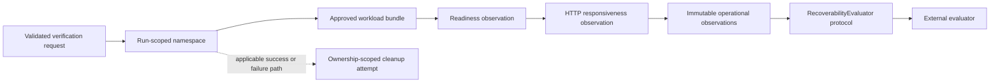
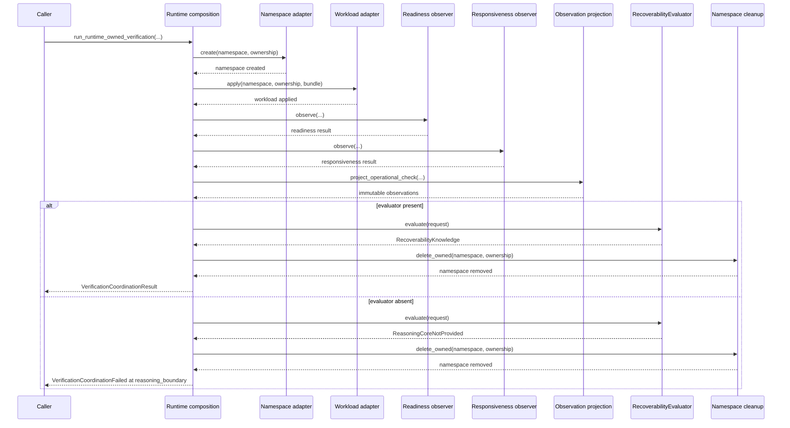

# Brace Platform Architecture

## 1. Scope and purpose

This document describes the public architecture of Brace Platform: a Kubernetes recoverability-verification orchestration platform with a pluggable reasoning boundary. It covers the public modules under `src/brace/`, the boundary contract under `src/brace/reasoning/`, the packaging arrangement, and the verification strategy.

The platform's responsibility ends where decision making begins. Brace Platform executes and observes an isolated Kubernetes namespace per run, applies an approved workload bundle, projects operational results into immutable observations, and presents those observations to an injected evaluator through a defined protocol. The public platform does not implement backup restoration, volume snapshot restores, or database state recovery. Every public platform component described here is implemented in the current repository. Reaching an authoritative recoverability conclusion requires an injected `RecoverabilityEvaluator`, whose implementation is external by design.

## Public V1 Architecture at a Glance



The diagram describes the public package boundary. Public tests use in-process test doubles. The diagram does not represent backup restoration or live-cluster proof. Cleanup is attempted and failures are preserved; resource absence is not proven by the public tests.

For a presentation-oriented view of the same public boundary, see the [public architecture graphic](assets/brace-platform-v1-public-architecture.png).

## 2. Public system boundary

The system is split along one intentional boundary.

```
Kubernetes execution and observation
    -> immutable operational observations
    -> RecoverabilityEvaluator protocol
    -> RecoverabilityKnowledge
```

- The **platform** (public) creates and removes run-scoped namespaces, applies approved workload bundles, observes readiness and responsiveness, and projects observations. It never decides recoverability.
- The **evaluator** (external) receives one boundary request per run and returns an immutable `RecoverabilityKnowledge` result. It never operates infrastructure.
- The platform supplies an evaluator by dependency injection. When no evaluator is provided, the platform completes every operational phase and fails at the boundary with `ReasoningCoreNotProvided`.

The platform holds no knowledge of how an evaluator derives its result; that derivation is not part of this repository and is not documented here.

## 3. Component responsibilities

| Component | Module | Responsibility |
|---|---|---|
| Request validation | `_runtime_owned_request.py` | Parse and strictly validate the approved run request: identities, ownership, bundle shape, port alignment, replica count, and image digest pinning. |
| Namespace adapter | `_kubernetes_namespace.py` | Create, inspect, and ownership-scoped deletion of the run namespace. |
| Workload adapter | `_kubernetes_workload.py` | Apply the approved deployment/service/config map and inspect for exact-match confirmation. |
| Readiness observer | `_kubernetes_readiness.py` | Observe Kubernetes readiness within a bounded convergence deadline. |
| Responsiveness observer | `_kubernetes_responsiveness.py` | Observe in-cluster service responsiveness with bounded retry and timeout policy. |
| Convergence engine | `_runtime_observation_convergence.py` | Deadline-bounded sampling, retryable transient classification, and timeout handling shared by the observers. |
| Transport | `_http_client_transport.py` | Minimal stdlib HTTP transport with strict error classification for responsiveness observation. |
| Projection | `_operational_projection.py` | Deterministically project operational check results into immutable evidence records. |
| Coordinator | `_runtime_owned_verification.py` | Sequence the exact public phases, record each phase result, perform the boundary handoff, and enforce cleanup semantics. |
| Composition | `_runtime_owned_composition.py` | Build adapters, observers, transport, clocks, and timeouts, and wire the optional evaluator into the coordinator. |
| Boundary | `reasoning/boundary.py` | Define the `RecoverabilityEvaluator` protocol, the structural `EvaluationRequest` contract, `evaluate_recoverability`, and the `ReasoningCoreNotProvided` exception. `RecoverabilityKnowledge` is defined in `_recoverability_knowledge.py` and used by the boundary contract. |
| Evidence model | `_evidence_kind.py`, `_recovery_observation.py`, `_recovery_event.py`, `_recoverability_knowledge.py` | Immutable value types that flow from the platform to the boundary. |

## 4. Runtime sequence

A run executes the exact public phases in order:

1. `namespace_create` — the namespace adapter creates the run-scoped namespace under explicit ownership.
2. `workload_apply` — the workload adapter applies the approved bundle (deployment, service, config map).
3. `readiness_observe` — the readiness observer samples Kubernetes readiness until observed or until its deadline.
4. `responsiveness_observe` — the responsiveness observer samples the service over the transport until observed or until its deadline.
5. `observation_project` — the projection function converts each operational check result into an immutable evidence record.
6. `reasoning_boundary` — the coordinator builds the boundary request and calls the evaluator through the protocol.
7. `namespace_cleanup` — the namespace adapter removes the run namespace under ownership.

Every phase is recorded as an `ExecutionPhaseResult` with its phase and success flag. A phase recording `succeeded=True` indicates that the operational lifecycle step executed without an unhandled error; it is distinct from whether the observed check condition evaluated to affirmative or negative. These are operational lifecycle phases of the platform; they are not stages of an evaluator.



## 5. Identity and ownership invariants

The following exact invariants are enforced before operational I/O, collectively by the request parser, the validated value types, and coordinator entry validation:

- `recovery_event.workload_id` equals `protected_workload.workload_id`
- `namespace.run_id` equals `run_id`
- `ownership.run_id` equals `run_id`
- `ownership.workload_id` equals `protected_workload.workload_id`
- `ownership.bundle` equals `workload_bundle.identity`
- `service.target_port` equals `deployment.container.container_port`
- `replicas` equals `1`
- images must use `@sha256:` followed by exactly 64 hexadecimal characters (the retained validator accepts lowercase `a`–`f`)

The boundary request additionally enforces, for every projected observation:

- projected observation event IDs equal `recovery_event.event_id`
- projected observation workload IDs equal `protected_workload.workload_id`

Together these invariants establish **operational identity continuity**: every artifact in a run — namespace, ownership, event, observations, and workload — is bound to the same run, event, and workload references from request acceptance through boundary handoff. These invariants describe the platform's identity and lifecycle guarantees; they are not a recoverability decision procedure.

## 6. Observation and deterministic projection

The projection function `project_operational_check(run_id, protected_workload, recovery_event, result)` maps each operational check result to an evidence record with:

- an evidence kind derived deterministically from the check kind (`KUBERNETES_READY` maps to `EvidenceKind.KUBERNETES_READINESS`; `APPLICATION_RESPONSIVE` maps to `EvidenceKind.APPLICATION_RESPONSIVENESS`);
- a deterministic identity derived from exactly `run_id`, `recovery_event_id`, `workload_id`, and `evidence_kind`;
- the event reference and workload reference carried verbatim.

`EvidenceKind` is an exact two-member enumeration: `KUBERNETES_READINESS` and `APPLICATION_RESPONSIVENESS`. Observations are frozen dataclasses; once projected they cannot be mutated. The coordinator returns the same observation objects it hands across the boundary, so the caller can verify that what the evaluator received is exactly what the platform produced.

## 7. Evaluator dependency inversion

`reasoning/boundary.py` defines the contract between the public platform and the decision component:

- `RecoverabilityEvaluator` — a runtime-checkable protocol with a single `evaluate(request)` operation returning `RecoverabilityKnowledge`;
- `EvaluationRequest` — the structural envelope carrying run identity, the protected workload, the recovery event, and the projected observations;
- `evaluate_recoverability(request, evaluator)` — the single crossing point: with an evaluator it delegates; without one it raises `ReasoningCoreNotProvided`;
- `RecoverabilityKnowledge` — the immutable result type returned by an evaluator.

The coordinator receives the evaluator by dependency injection through the composition function and holds it only as the protocol. The platform therefore has no compile-time or runtime knowledge of evaluator internals, and an evaluator implementation cannot be surprised by platform internals either: it receives exactly the boundary request described here and performs no infrastructure operations.


## 8. Failure and cleanup model

Failure behavior is explicit and test-verified:

- **Phase failure.** Any operational or boundary phase failure is recorded with the failed phase and the original exception, and a `VerificationCoordinationFailed` is raised carrying `failed_phase`, `primary_failure`, `cleanup_failure`, and the full phase record.
- **Cleanup after failure.** After a phase failure, ownership-scoped namespace deletion is attempted; if that deletion also fails, the cleanup exception is retained separately on `cleanup_failure` (the original failure is never overwritten).
- **Cleanup after success.** After a successful boundary handoff, namespace deletion is the final phase. If it fails, `VerificationCleanupFailed` is raised and preserves the produced knowledge, observations, and phase record; the cleanup exception is available as `cleanup_failure` and as the exception cause.
- **Boundary failure mode.** With no evaluator, the platform completes all operational phases and the boundary crossing raises `ReasoningCoreNotProvided`, surfaced inside `VerificationCoordinationFailed` at the `reasoning_boundary` phase, followed by cleanup.

## 9. Package and dependency boundaries

The package is `brace-platform` 0.1.0, src-layout via `pyproject.toml`:

- `requires-python = ">=3.10"` (derived from the retained source's runtime-evaluated type unions and dataclass `slots=True`);
- runtime dependencies: `kubernetes` and `urllib3` — exactly the third-party packages directly imported by retained production modules (verified by `tests/test_package_installation.py`, which asserts declared dependencies and retained imports match in both directions);
- development dependencies: `pytest` and `build`;
- `MANIFEST.in` prunes `tests/` from the source distribution so neither distribution carries test files;
- the wheel ships only the `brace` package and its metadata; the sdist carries the package sources and packaging files.

The public package is dependency-closed: importing any module of the installed package resolves only standard library, `brace` itself, and the declared runtime dependencies.

## 10. Verification strategy

The test suite (`tests/`) is structured in three layers:

- **Authority-chain tests** (`test_runtime_owned_verification.py`) — drive the real coordinator with in-process fakes that replay production-built payloads: exact phase order, single cleanup, boundary request identity, projected observations, every per-phase failure path with cleanup, both cleanup-failure modes, and every identity invariant rejection before I/O.
- **Composition tests** (`test_runtime_owned_composition.py`) — cover the public entry point: exact evaluator threading, the full success path with an injected evaluator, the no-evaluator path through the real boundary with cleanup, and evaluator forwarding.
- **Packaging guards** (`test_package_installation.py`) — verify pyproject metadata, dependency/import closure, absence of private references in packaging files, and the src discovery layout.

Tests never contact a Kubernetes cluster: adapters and observers are fakes, and the composition patching covers config loading and client construction. These in-process fake-based tests verify coordinator authority and failure paths, but do not constitute live-cluster operational proof. The suite currently passes **42 tests**.

## 11. Security and disclosure posture

- **Digest pinning.** Container images are required to be pinned with `@sha256:` plus exactly 64 hexadecimal characters; the request is rejected otherwise. No registry, account, or environment identifiers appear in this repository.
- **Ownership-scoped deletion.** Namespace removal is bound to run identity and ownership; cleanup is attempted after failures and its own failure is reported explicitly.
- **No credentials.** No credentials, keys, tokens, or environment-specific paths are present in source, tests, packaging, or distributions; the packaging guards scan for them.
- **No cluster contact in tests.** The public test suite runs entirely in-process against fakes; nothing in the repository connects to a cluster during installation, import, or testing.
- **Boundary opacity.** The public boundary deliberately does not describe how an evaluator reaches a conclusion. The derivation procedure, and any treatment of the evidence it applies, is a property of the external evaluator and is intentionally outside this artifact.

## 12. What is intentionally external

- The `RecoverabilityEvaluator` implementation — the decision component that transforms a boundary request into `RecoverabilityKnowledge` — is not distributed with this repository.
- Genuine backup restoration, snapshot replay, storage volume recovery, and live infrastructure proof are external to this public platform implementation.
- Reaching an authoritative recoverability conclusion requires an injected evaluator; without one, the platform operates fully through the operational phases and stops at the boundary with `ReasoningCoreNotProvided`.
- Kubernetes credentials, cluster access, and runtime configuration are the caller's responsibility.
- Any reasoning capability beyond the protocol contract is external by design; this repository documents only the platform, the boundary, and their verified behavior.
