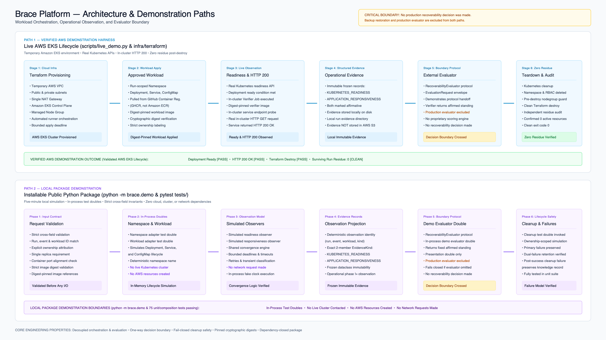

# Brace Platform Architecture Diagram Source

This document contains the maintainable Mermaid source specification corresponding to the presentation asset [brace-platform-architecture.png](brace-platform-architecture.png).

## Visual Presentation Asset

## Architecture Specifications

The architecture presents two related but separate demonstration surfaces:

1. **Top Path: Verified AWS Demonstration Harness**
   Standalone Terraform infrastructure (`infra/terraform`) and lifecycle orchestration runner (`scripts/live_demo.py`) validated on Amazon EKS in AWS region `ap-south-1`. Pulls digest-pinned images from GitHub Container Registry (GHCR), observes genuine Kubernetes deployment readiness and in-cluster HTTP 200 responses, stores evidence locally on disk, destroys temporary cloud resources, and verifies zero cloud residue.

2. **Bottom Path: Local Package Demonstration**
   Installable Python package (`python -m brace.demo`) orchestrating strict cross-field request validation, run-scoped namespace lifecycle, workload application, bounded readiness and HTTP observation, immutable observation projection, boundary protocol handoff, and ownership-scoped cleanup using in-process test doubles. Operates with zero cluster, cloud, or network dependencies.

> **Universal Boundary Notice**
> *No production recoverability decision was made.*
> Neither path implements backup restoration, and neither includes the proprietary production recoverability evaluator.

---

## Mermaid Source Representation

```mermaid
flowchart TD
    %% Global Styling
    classDef awsNode fill:#f0f9ff,stroke:#0284c7,stroke-width:1.5px,color:#0f172a;
    classDef localNode fill:#faf5ff,stroke:#7c3aed,stroke-width:1.5px,color:#0f172a;
    classDef boundaryNode fill:#fffbeb,stroke:#d97706,stroke-width:2px,stroke-dasharray: 5 5,color:#92400e;
    classDef outcomeNode fill:#f0fdf4,stroke:#16a34a,stroke-width:2px,color:#166534;
    classDef localOutcomeNode fill:#faf5ff,stroke:#9333ea,stroke-width:2px,color:#581c87;

    %% =========================================================================
    %% TOP PATH: VERIFIED AWS DEMONSTRATION HARNESS
    %% =========================================================================
    subgraph Path1["TOP PATH: VERIFIED AWS DEMONSTRATION HARNESS (scripts/live_demo.py & infra/terraform)"]
        direction LR

        P1_TF["<b>1. Terraform Provisioning</b><br/>• Temporary AWS VPC<br/>• Public & private subnets<br/>• Single NAT Gateway<br/>• Amazon EKS Control Plane<br/>• Managed Node Group<br/>• Bounded apply deadline"]:::awsNode

        P1_WL["<b>2. Approved Workload</b><br/>• Run-scoped Namespace<br/>• Deployment, Service, ConfigMap<br/>• GitHub Container Registry (GHCR)<br/>• Digest-pinned workload image<br/>• Strict ownership labeling"]:::awsNode

        P1_OBS["<b>3. Real In-Cluster Observation</b><br/>• Real Kubernetes readiness API<br/>• Deployment ready condition met<br/>• In-cluster Verifier Job executed<br/>• Digest-pinned verifier image<br/>• Real HTTP 200 OK observed"]:::awsNode

        P1_EVI["<b>4. Operational Evidence</b><br/>• Immutable observation records:<br/>  - KUBERNETES_READINESS<br/>  - APPLICATION_RESPONSIVENESS<br/>• Stored locally (.demo/evidence/)<br/>• NOT stored in Amazon S3<br/>• Sanitized command logs"]:::awsNode

        P1_EVAL["<b>5. Evaluator Boundary</b><br/>• RecoverabilityEvaluator protocol<br/>• Demonstration verifier double<br/>• Fixed affirmed standing returned<br/>• Production evaluator EXCLUDED<br/>• No proprietary decision logic<br/>• <i>No production decision made</i>"]:::boundaryNode

        P1_CLEAN["<b>6. Teardown & Audit</b><br/>• Kubernetes cleanup (NS, RBAC, Job)<br/>• Pre-destroy nodegroup guard<br/>• Clean Terraform destroy<br/>• Independent residue audit<br/>• Confirmed 0 active resources<br/>• Clean exit code 0"]:::outcomeNode

        P1_TF --> P1_WL --> P1_OBS --> P1_EVI --> P1_EVAL --> P1_CLEAN
    end

    %% =========================================================================
    %% BOTTOM PATH: LOCAL PACKAGE DEMONSTRATION
    %% =========================================================================
    subgraph Path2["BOTTOM PATH: LOCAL PACKAGE DEMONSTRATION (python -m brace.demo & pytest tests/)"]
        direction LR

        P2_VAL["<b>1. Request Validation</b><br/>• Strict cross-field invariants<br/>• Run, event & workload matching<br/>• Single replica requirement<br/>• Port alignment verification<br/>• Digest-pinned image references"]:::localNode

        P2_DBL["<b>2. Namespace & Workload Doubles</b><br/>• In-process namespace double<br/>• In-process workload double<br/>• Simulates Deployment, Service,<br/>  and ConfigMap lifecycle<br/>• Deterministic naming<br/>• <b>No live cluster contacted</b>"]:::localNode

        P2_OBS["<b>3. Simulated Observers</b><br/>• Simulated readiness observer<br/>• Simulated responsiveness observer<br/>• Shared convergence engine<br/>• Deadline & timeout policy<br/>• Transient error classification<br/>• <b>No network requests made</b>"]:::localNode

        P2_PROJ["<b>4. Operational Projection</b><br/>• Deterministic observation IDs<br/>• Exact 2-member EvidenceKind:<br/>  - KUBERNETES_READINESS<br/>  - APPLICATION_RESPONSIVENESS<br/>• Frozen dataclass records<br/>• Lifecycle phase != observation"]:::localNode

        P2_EVAL["<b>5. Demo Evaluator Double</b><br/>• RecoverabilityEvaluator protocol<br/>• In-process demo evaluator double<br/>• Fixed affirmed standing returned<br/>• Production evaluator EXCLUDED<br/>• Fails closed if evaluator omitted<br/>• <i>No production decision made</i>"]:::boundaryNode

        P2_CLEAN["<b>6. Cleanup Double & Failure Model</b><br/>• In-process cleanup double<br/>• Ownership-scoped deletion<br/>• Primary failure preservation<br/>• Dual-failure retention verified<br/>• Post-success cleanup failure handling<br/>• <b>No AWS resources created</b>"]:::localOutcomeNode

        P2_VAL --> P2_DBL --> P2_OBS --> P2_PROJ --> P2_EVAL --> P2_CLEAN
    end
```

---

## Component and Boundary Matrix

| Architectural Feature | Verified AWS Demonstration Harness | Local Package Demonstration |
|---|---|---|
| **Invocation** | `python scripts/live_demo.py` | `python -m brace.demo` or `pytest tests/` |
| **Infrastructure** | Temporary AWS VPC, subnets, NAT gateway, EKS cluster, managed node group | None (in-process Python runtime) |
| **Kubernetes API** | Live Amazon EKS Control Plane | In-process fake adapter |
| **Workload Deployment** | Live Kubernetes Deployment, Service, ConfigMap | In-process fake workload adapter |
| **Container Registry** | GitHub Container Registry (`ghcr.io`) | None (strings validated by regex) |
| **Image Digest Pinning** | Enforced: `@sha256:` + 64 hex characters | Enforced: `@sha256:` + 64 hex characters |
| **Readiness Observation** | Real Kubernetes deployment condition polling | Simulated observer with test clock |
| **Responsiveness Observation** | In-cluster Verifier Job with real HTTP 200 GET | Simulated observer over fake transport |
| **Evidence Output** | Saved locally to `.demo/evidence/<run-id>/` | Projected frozen dataclass in memory |
| **Cloud Storage (S3)** | Excluded (evidence stored on local disk only) | Excluded |
| **Evaluator Protocol** | External `RecoverabilityEvaluator` boundary | External `RecoverabilityEvaluator` boundary |
| **Production Evaluator** | Excluded (demonstration verifier returns affirmed standing) | Excluded (demo double returns affirmed standing) |
| **Production Decision** | **No production recoverability decision was made** | **No production recoverability decision was made** |
| **Teardown & Cleanup** | Namespace deleted; Terraform resources destroyed | In-process cleanup double executed |
| **Residue Audit** | Independent AWS CLI audit confirmed 0 surviving resources | Not applicable (in-memory execution) |
| **Backup Restoration** | Excluded (not implemented or exercised) | Excluded (not implemented or exercised) |
