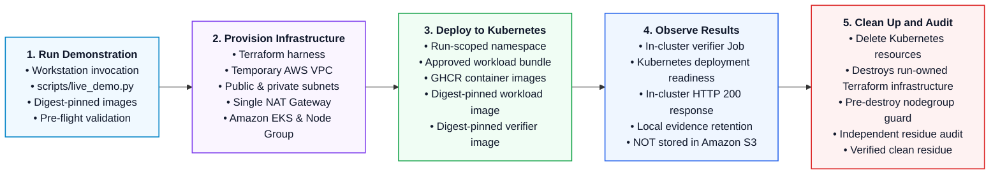

# Brace Platform AWS Demonstration Lifecycle Source

This document contains the maintainable Mermaid source specification corresponding to the presentation asset [brace-platform-aws-lifecycle.png](brace-platform-aws-lifecycle.png).

## Visual Presentation Asset

*Verified AWS demonstration harness: temporary infrastructure, real in-cluster observations, ownership-scoped cleanup and independent residue auditing.*

## Architecture Specifications

The verified AWS demonstration harness executes a self-cleaning, five-stage lifecycle against temporary AWS cloud infrastructure:

1. **Stage 1: Run Demonstration**: Workstation invokes the lifecycle runner (`scripts/live_demo.py`) with two digest-pinned container image references.
2. **Stage 2: Provision Temporary Infrastructure**: Terraform demonstration harness (`infra/terraform`) provisions a temporary AWS VPC, public and private subnets, a NAT gateway, and an Amazon EKS control plane with a managed node group.
3. **Stage 3: Deploy to Kubernetes**: Standard Kubernetes manifests apply an approved sample workload (Deployment, Service, ConfigMap) and a demonstration verifier Job into a run-scoped namespace, pulling digest-pinned images from GitHub Container Registry (`ghcr.io`).
4. **Stage 4: Observe Results**: The demonstration verifier Job samples genuine Kubernetes readiness and executes an in-cluster HTTP probe against the workload service, recording real operational results.
5. **Stage 5: Clean Up and Audit**: Run-scoped Kubernetes resources are deleted, Terraform cleanly destroys run-owned Terraform infrastructure, and an independent out-of-band audit confirms zero surviving residual cloud resources.

> **Universal Boundary Notice**
> *No production recoverability decision was made.*
> The demonstration verifier returns fixed affirmed standing across the external evaluator boundary. Backup restoration is not performed, and evidence is retained exclusively on local disk (not stored in Amazon S3).

---

## Mermaid Source Representation

---

## Component and Boundary Matrix

| Architectural Feature | Verified AWS Demonstration Specification |
|---|---|
| **Invocation** | `python scripts/live_demo.py` from developer workstation |
| **Infrastructure Engine** | Terraform demonstration harness (`infra/terraform`) |
| **Cloud Infrastructure** | Temporary AWS VPC, public & private subnets, NAT gateway |
| **Container Platform** | Amazon Elastic Kubernetes Service (Amazon EKS) & Managed Node Group |
| **Container Registry** | GitHub Container Registry (`ghcr.io`), not Amazon ECR |
| **Workload Deployment** | Run-scoped Namespace, Deployment, Service, ConfigMap |
| **Workload Image** | Digest-pinned workload image |
| **Verifier Image** | Digest-pinned verifier image |
| **Readiness Observation** | Real Kubernetes deployment available replicas condition observed |
| **Responsiveness Observation** | In-cluster verifier Job observing real HTTP 200 response |
| **Evidence Storage** | Retained locally on disk in `.demo/evidence/` (NOT in Amazon S3) |
| **Evaluator Boundary** | External `RecoverabilityEvaluator` boundary protocol |
| **Evaluator Decision** | Demonstration verifier returns affirmed standing; *No production recoverability decision was made.* |
| **Infrastructure Teardown** | Destroys run-owned Terraform infrastructure |
| **Residue Audit** | Independent out-of-band audit confirms zero surviving run-owned resources |
| **Backup Restoration** | Excluded (not implemented or exercised) |
