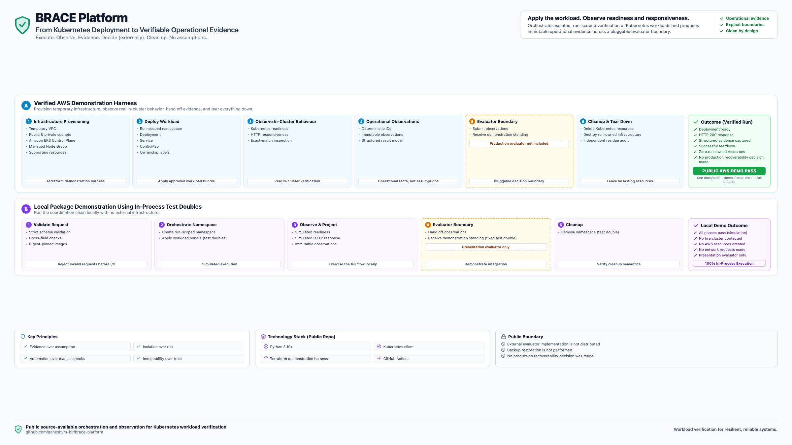

# Brace Platform Two-Path Demonstration Overview Source

This document contains the maintainable Mermaid source specification corresponding to the presentation asset [brace-platform-two-path-overview.png](brace-platform-two-path-overview.png).

## Visual Presentation Asset

*Brace Platform demonstration overview showing the verified AWS demonstration harness (top lane) and the local package demonstration using in-process test doubles (bottom lane).*

## Architecture Specifications

The repository provides two related but architecturally separate demonstration surfaces:

1. **Top Lane: Verified AWS Demonstration Harness**
   A separately invoked demonstration harness (`scripts/live_demo.py` & `infra/terraform`) that provisions temporary AWS infrastructure, applies approved Kubernetes manifests, observes genuine in-cluster readiness and HTTP 200 responsiveness, projects operational evidence across an external evaluator boundary, cleanly tears down run-owned infrastructure, and audits for zero residue.

2. **Bottom Lane: Local Package Demonstration Using In-Process Test Doubles**
   The installable Python package (`python -m brace.demo`) orchestrating strict request validation, run-scoped namespace lifecycle, workload application, simulated readiness and responsiveness observation, immutable observation projection, boundary delegation, and ownership-scoped cleanup using in-process test doubles with zero external dependencies.

### Public Boundary

- External evaluator implementation is not distributed
- Backup restoration is not performed
- No production recoverability decision was made

---

## Mermaid Source Representation

```mermaid
flowchart TD
    %% Global Styling
    classDef awsNode fill:#f0f9ff,stroke:#0284c7,stroke-width:1.5px,color:#0f172a;
    classDef localNode fill:#faf5ff,stroke:#7c3aed,stroke-width:1.5px,color:#0f172a;
    classDef boundaryNode fill:#fffbeb,stroke:#d97706,stroke-width:2px,stroke-dasharray: 5 5,color:#92400e;
    classDef outcomeNode fill:#f0fdf4,stroke:#16a34a,stroke-width:2px,color:#166534;
    classDef localOutcomeNode fill:#faf5ff,stroke:#9333ea,stroke-width:2px,color:#581c87;

    %% =========================================================================
    %% LANE A: VERIFIED AWS DEMONSTRATION HARNESS
    %% =========================================================================
    subgraph LaneA["LANE A: VERIFIED AWS DEMONSTRATION HARNESS (scripts/live_demo.py & infra/terraform)"]
        direction LR

        A1["<b>1. Infrastructure Provisioning</b><br/>• Terraform demonstration harness<br/>• Temporary AWS VPC & subnets<br/>• Amazon EKS Control Plane<br/>• Managed Node Group"]:::awsNode

        A2["<b>2. Deploy Workload</b><br/>• Kubernetes manifests<br/>• Run-scoped namespace<br/>• Deployment, Service, ConfigMap<br/>• Digest-pinned images"]:::awsNode

        A3["<b>3. In-Cluster Observation</b><br/>• Real in-cluster verification<br/>• Kubernetes readiness observed<br/>• In-cluster HTTP 200 observed"]:::awsNode

        A4["<b>4. Operational Observations</b><br/>• Deterministic IDs<br/>• Immutable observations<br/>• Structured evidence model"]:::awsNode

        A5["<b>5. Evaluator Boundary</b><br/>• External boundary protocol<br/>• Receive demonstration standing<br/>• <i>Production evaluator not included</i>"]:::boundaryNode

        A6["<b>6. Cleanup & Tear Down</b><br/>• Delete Kubernetes resources<br/>• Destroy run-owned infrastructure<br/>• Independent residue audit"]:::outcomeNode

        A1 --> A2 --> A3 --> A4 --> A5 --> A6
    end

    %% =========================================================================
    %% LANE B: LOCAL PACKAGE DEMONSTRATION
    %% =========================================================================
    subgraph LaneB["LANE B: LOCAL PACKAGE DEMONSTRATION USING IN-PROCESS TEST DOUBLES (python -m brace.demo)"]
        direction LR

        B1["<b>1. Validate Request</b><br/>• Strict schema validation<br/>• Cross-field integrity checks<br/>• Digest-pinned image references"]:::localNode

        B2["<b>2. Orchestrate Namespace</b><br/>• Run-scoped namespace double<br/>• Workload bundle doubles<br/>• Simulated execution"]:::localNode

        B3["<b>3. Observe & Project</b><br/>• Simulated readiness observer<br/>• Simulated HTTP responsiveness<br/>• Immutable observations"]:::localNode

        B4["<b>4. Evaluator Boundary</b><br/>• External boundary protocol<br/>• In-process evaluator double<br/>• Fixed demonstration standing"]:::boundaryNode

        B5["<b>5. Cleanup</b><br/>• Cleanup test double<br/>• Ownership-scoped deletion<br/>• Failure preservation"]:::localOutcomeNode

        B1 --> B2 --> B3 --> B4 --> B5
    end
```

---

## Component and Boundary Matrix

| Dimension | Verified AWS Demonstration Harness | Local Package Demonstration |
|---|---|---|
| **Execution Surface** | `python scripts/live_demo.py` & `infra/terraform` | `python -m brace.demo` & `pytest tests/` |
| **Infrastructure** | Temporary AWS VPC, subnets, NAT gateway, EKS cluster | None (in-process Python runtime) |
| **Kubernetes API** | Live Amazon EKS Control Plane | In-process test doubles |
| **Workload Deployment** | Standard Kubernetes manifests | In-process test doubles |
| **Image Resolution** | GitHub Container Registry (`ghcr.io`) | String format validated by regex |
| **Readiness Observation** | Real deployment condition polling | Simulated observer with test clock |
| **Responsiveness Observation** | In-cluster verifier Job with real HTTP 200 probe | Simulated observer over fake transport |
| **Evidence Output** | Saved locally to `.demo/evidence/` (NOT in S3) | Projected frozen dataclass in memory |
| **Evaluator Protocol** | External `RecoverabilityEvaluator` boundary | External `RecoverabilityEvaluator` boundary |
| **Decision Standing** | Demonstration verifier returns affirmed standing | Test double returns affirmed standing |
| **Production Decision** | **No production recoverability decision was made** | **No production recoverability decision was made** |
| **Teardown & Audit** | Destroys run-owned Terraform infrastructure & residue audit | In-process cleanup double executed |
| **Live Cluster Contact** | Yes (temporary EKS cluster) | None (no live cluster contacted) |
| **AWS Resources Created** | Yes (temporary, run-scoped) | None (no AWS resources created) |
| **Network Requests Made** | Yes (AWS APIs, GHCR, in-cluster HTTP) | None (no network requests made) |
| **Backup Restoration** | Excluded (not implemented or exercised) | Excluded (not implemented or exercised) |
