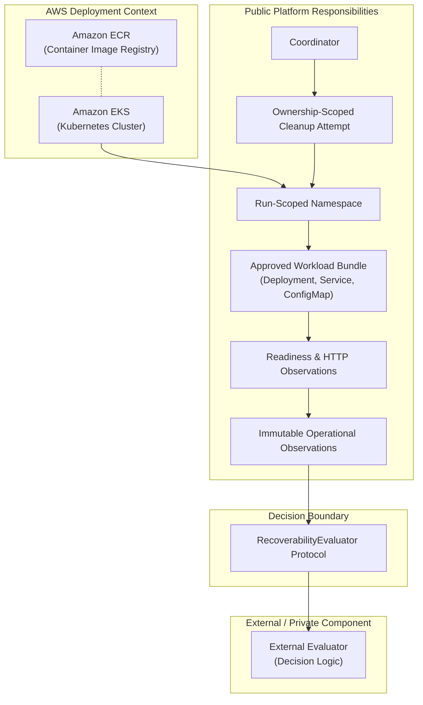

# AWS Deployment Case Study

## Scope

This document provides a sanitized, high-level overview of an AWS deployment context for Brace Platform.

Please note the following boundaries:
- This is a sanitized deployment-context case study, not an operational runbook or deployment guide.
- The public repository does not provision AWS infrastructure, execute Terraform, or automate cloud resources.
- The public repository does not contain AWS credentials, cloud infrastructure automation, backup restoration logic, or production evaluator implementations.

## Engineering Question

How can a temporary Kubernetes verification environment separate workload execution and observation from an external decision component?

In verification workflows, testing application availability requires deploying workloads to a cluster, observing health, and generating structured evidence for decision systems. The engineering challenge is isolating operational orchestration and infrastructure observation from the evaluation logic that decides whether recoverability has been demonstrated, while ensuring that the orchestration records cleanup attempts and preserves cleanup failures. This public repository demonstrates that separation of concerns without claiming to solve end-to-end disaster recovery.

## High-Level Deployment Context

In a representative cloud deployment, Brace Platform operates against standard managed cloud services:

- **Amazon Elastic Container Registry (Amazon ECR)**: Serves as a source of container images pinned by cryptographic digest.
- **Amazon Elastic Kubernetes Service (Amazon EKS)**: Acts as the target Kubernetes execution environment hosting the cluster runtime.
- **Run-Scoped Kubernetes Namespace**: Created with unique ownership metadata for the duration of a verification exercise.
- **Approved Workload Bundle**: Contains Deployment, Service, and ConfigMap definitions applied into the isolated namespace.
- **Operational Observations**: Kubernetes readiness and HTTP endpoint responsiveness are sampled against bounded deadlines.
- **External Evaluator Boundary**: Observed evidence is packaged into structured envelopes and presented across a defined protocol.
- **Ownership-Scoped Cleanup Attempts**: The coordinator attempts ownership-scoped namespace deletion to clean up cluster resources.

## Architecture and Boundary Diagram

The visual groupings distinguish between:
1. **AWS Deployment Context**: Cloud environment hosting the container registry and Kubernetes cluster runtime.
2. **Public Platform Responsibilities**: In-cluster namespace lifecycle, workload application, readiness and HTTP observation, evidence projection, and ownership-scoped cleanup attempts.
3. **Decision Boundary**: The one-way protocol contract separating evidence collection from decision making.
4. **External Evaluator**: The decision logic that receives evidence and renders a recoverability conclusion.

## Public Package Responsibilities

The public package provides the following capabilities:

- **Executable verification coverage**: Coordinator sequencing, identity validation, boundary checks, failure preservation, timestamp behavior, and ownership-scoped cleanup attempts are covered by executable public tests.
- **Inspectable platform implementation**: Kubernetes namespace, workload, readiness, responsiveness, and HTTP transport capabilities are present as inspectable public implementation, while coordinator tests substitute adapters and observers with in-process doubles.
- **Request and identity validation**: Validates run, event, workload, ownership, port, replica, and digest references before invoking any adapter.
- **Namespace lifecycle orchestration**: Sequences namespace creation, workload deployment, evidence gathering, and namespace deletion.
- **Workload application and inspection**: Applies and inspects the expected Deployment, Service, and ConfigMap resources.
- **Bounded readiness observation**: Samples Kubernetes deployment readiness against a configurable deadline.
- **Bounded HTTP responsiveness observation**: Probes application HTTP endpoints using structured retry and timeout policies.
- **Deterministic observation projection**: Converts check results into immutable frozen dataclass records with deterministic IDs.
- **Evaluator delegation**: Packages observations into an `EvaluationRequest` and passes them to the injected evaluator protocol.
- **Failure preservation**: Captures primary phase exceptions, ensures cleanup failure does not overwrite primary errors, and preserves generated knowledge if cleanup fails after evaluation.
- **Ownership-scoped cleanup attempts**: Attempts ownership-scoped namespace deletion after both successful runs and operational failures.

## External or Private Responsibilities

The following functions are external to the public platform repository:

- **AWS infrastructure provisioning**: Cloud networking, compute clusters, and managed services.
- **Container publication**: Building container images, vulnerability scanning, and publishing images to Amazon ECR.
- **Backup creation and restoration**: Snapshot management, database dumps, volume restores, and replication jobs.
- **Storage and database recovery**: Restoring physical volumes, replaying transaction logs, or validating persistent database state.
- **Production evaluator implementation**: Proprietary decision engines, inference rules, and recoverability evaluation algorithms.
- **Evidence interpretation and decision logic**: Business logic determining whether observed evidence satisfies organizational recovery standards.
- **Environment credentials and runtime configuration**: Cloud provider credentials, cluster access configurations, and authentication tokens.

## Evidence Boundary

It is important to maintain an exact distinction between local verification evidence and cloud deployment context:

- **In-process test doubles**: Public unit tests exercise coordinator state transitions, failure handling, and boundary handoffs using test doubles. They do not connect to Amazon EKS or test live AWS infrastructure.
- **Packaging and boundary gates**: Public CI workflows verify Python package metadata, dependency closure, module allowlists, and distribution content hygiene.
- **Deployment context**: The architecture diagrams and AWS service references in this case study provide contextual orientation for how the platform operates inside cloud environments; they do not represent automated provisioning code in this repository.
- **Absence of live cloud evidence**: This document does not present live cloud benchmark logs, execution metrics from running AWS clusters, or production recovery certifications.

## What This Case Study Does Not Claim

This case study explicitly excludes the following claims:

- It does not claim live AWS provisioning proof or cluster infrastructure automation.
- It does not claim backup restoration proof, snapshot replay, or storage recovery.
- It does not claim database consistency, data integrity validation, or volume durability.
- It does not claim compliance with Recovery Time Objectives (RTO) or Recovery Point Objectives (RPO).
- It does not claim multi-region failover automation or cross-region replication.
- It does not claim performance benchmarking, scale limits, or load test certification.
- It does not claim mathematical or operational correctness of external evaluators.
- It does not claim universal recoverability guarantees or automated disaster recovery.

## Interview Discussion Points

Five key architecture topics relevant to this system design:

1. **Separation of orchestration from evaluation**:
   Decoupling workload observation from the decision engine allows the platform to remain auditable, portable, and inspectable, while proprietary assessment models remain independent, substitutable components.

2. **Run-scoped namespace isolation**:
   Isolating each verification exercise within a run-scoped namespace bounded by deterministic run identifiers prevents cross-run contamination and enables safe, targeted resource deletion.

3. **Phase execution success vs observation outcome**:
   An operational phase completing with `succeeded=True` indicates only that the orchestration step ran without infrastructure failure. It does not mean that the observed workload satisfied functional or recoverability criteria.

4. **Preservation of primary failures alongside cleanup errors**:
   If an operational check fails and subsequent namespace deletion also fails, the coordinator preserves the primary error as the principal cause while retaining the cleanup error. This avoids masking root causes during troubleshooting.

5. **Separation of public platform engineering from private decision IP**:
   Open-sourcing runtime execution, observation gathering, and boundary contracts enables community review of infrastructure code without disclosing proprietary decision heuristics or internal assessment models.
