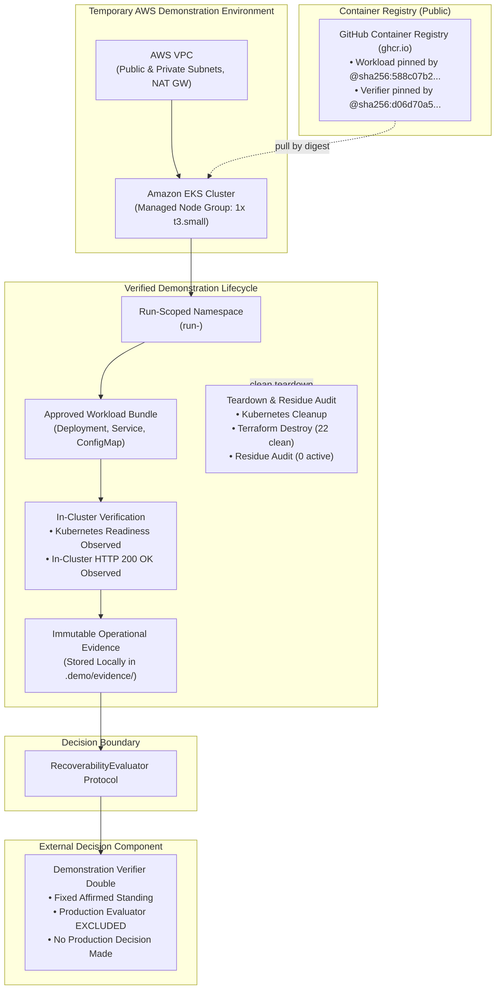

# AWS Deployment Case Study

## Scope and Architecture Context

This document provides a sanitized, architectural case study of the validated AWS demonstration harness for Brace Platform.

Please note the following boundaries:
- **Demonstration Distinction**: The repository provides two separate surfaces:
  1. The **installable public package (`brace`)**, which does not provision cloud resources and executes locally against in-process test doubles.
  2. The **verified AWS demonstration harness (`scripts/live_demo.py` & `infra/terraform`)**, a standalone, explicitly invoked harness that provisions temporary Amazon Web Services (AWS) infrastructure to demonstrate real in-cluster observation.
- **No Backup Restoration**: Neither the package nor the live AWS demonstration implements backup restoration, volume snapshots, storage recovery, or database replays.
- **External Evaluator Boundary**: The production evaluator, scoring logic, and decision algorithms are external and omitted. The demonstration uses an illustrative test double returning fixed affirmed standing. *No production recoverability decision was made.*
- **Sanitized Evidence**: All AWS account IDs, ARNs, VPC IDs, subnet IDs, security group IDs, NAT gateway IDs, KMS key IDs, and credentials are completely sanitized. Evidence is stored locally on disk and is **not** uploaded to Amazon S3.

For visual architecture, see the [Architecture Overview](assets/brace-platform-architecture.png).

---

## Engineering Question

How can an automated verification harness separate cloud infrastructure orchestration and workload observation from an external recoverability evaluation component while guaranteeing zero residual cloud resources?

In disaster recovery and platform assurance, verifying application availability requires deploying workloads to a target cluster, observing convergence and responsiveness, and projecting structured evidence for evaluation. The core engineering challenges are:
1. Isolating infrastructure execution and observation from decision-making logic.
2. Collecting real operational signals (Kubernetes deployment readiness and in-cluster HTTP status codes) without proprietary agents.
3. Guaranteeing deterministic teardown and proving zero cloud residue post-execution.

---

## Demonstration Infrastructure Context

The standalone demonstration harness operates against standard AWS and container services:

- **GitHub Container Registry (GHCR)**: Serves as the public container registry (`ghcr.io`) hosting digest-pinned workload and verifier images. (Amazon ECR is **not** used).
- **Temporary AWS VPC**: Created via `infra/terraform` with 2 public subnets, 2 private subnets, and a single NAT gateway for outbound image pulling.
- **Amazon Elastic Kubernetes Service (Amazon EKS)**: Managed Kubernetes control plane (Kubernetes 1.36) hosting an isolated execution environment.
- **Managed Node Group**: Single `t3.small` instance (`FreeTierEligible=true`, `x86_64`) providing cluster compute.
- **Run-Scoped Namespace**: Created with unique ownership metadata (`brace.platform/run-id`, `brace.platform/ownership-owner`) for the verification run.
- **Approved Workload Bundle**: Standard Deployment, Service, and ConfigMap definitions applied into the isolated namespace.
- **Operational Observations**: Real Kubernetes deployment readiness and in-cluster HTTP `200 OK` responsiveness gathered by an in-cluster verifier Job.
- **External Evaluator Boundary**: Observed evidence delivered across the `RecoverabilityEvaluator` protocol.
- **Zero-Residue Teardown**: Ownership-scoped Kubernetes cleanup, `terraform destroy` of all 22 cloud resources, and an independent AWS CLI residue audit.

---

## Architecture and Boundary Diagram

---

## Verified Demonstration Milestone Facts

The public AWS demonstration lifecycle was executed, verified, and frozen on commit `e8329b6`:

| Dimension | Verified Fact |
|---|---|
| **Status** | `PUBLIC AWS LIFECYCLE PASS` |
| **Milestone** | Verified Public Demonstration Lifecycle |
| **Commit** | `e8329b6d2150e1bcba787d96aa8e4dd238561c49` |
| **Run ID** | `895844a6-afb2-45e1-a2c6-30c1229dc844` |
| **AWS Region** | `ap-south-1` |
| **Node Instance Type** | `t3.small` |
| **Workload Image** | `ghcr.io/ganeshvm-blr/brace-platform-demo-workload@sha256:588c07b235103a9f73d5f069418c1b1e2966c57245fd4be4bab8658053a5650a` |
| **Verifier Image** | `ghcr.io/ganeshvm-blr/brace-platform-verifier@sha256:d06d70a5b892705ad537f05eb246d8171cc236d52310912b800789bc84509fc8` |
| **Readiness Observation** | Deployment `demo-workload` converged to ready status (`PASS`) |
| **Responsiveness Observation** | In-cluster HTTP GET returned status `200 OK` (`PASS`) |
| **Kubernetes Cleanup** | Namespace, Job, ConfigMap, ServiceAccount, and RBAC deleted (`PASS`) |
| **Terraform Teardown** | 22 resources cleanly destroyed with 0 errors (`PASS`) |
| **Residue Audit** | Independent audit confirmed 0 surviving run-owned AWS resources (`CLEAN`) |
| **Evidence Location** | `.demo/evidence/895844a6-afb2-45e1-a2c6-30c1229dc844/` (local disk only) |

See [docs/public-demo-freeze.md](public-demo-freeze.md) for the complete auditable record.

---

## Separation of Concerns: Package vs AWS Demonstration

| Dimension | Installable Package (`brace`) | Verified AWS Demonstration Harness |
|---|---|---|
| **Source Directory** | `src/brace/` | `infra/terraform/` & `scripts/live_demo.py` |
| **Cloud Provisioning** | None (does not provision AWS) | Provisions temporary VPC and EKS |
| **Kubernetes API** | Abstracted via adapter protocol | Real Amazon EKS Control Plane |
| **Observation Medium** | In-process test doubles | In-cluster Job and real HTTP probe |
| **Evidence Output** | In-memory frozen dataclasses | Written to `.demo/evidence/<run-id>/` |
| **Cloud Residue** | None (in-memory execution) | Independently audited zero residue |
| **Evaluator Contract** | `RecoverabilityEvaluator` protocol | `RecoverabilityEvaluator` protocol |
| **Production Evaluator** | Excluded | Excluded |
| **Backup Restoration** | Excluded | Excluded |

---

## What This Case Study Does Not Claim

This case study explicitly excludes the following claims:
- It does not claim backup restoration, snapshot replay, or storage recovery.
- It does not claim database consistency, state persistence, or transaction log recovery.
- It does not claim Recovery Time Objective (RTO) or Recovery Point Objective (RPO) compliance.
- It does not claim multi-region disaster recovery or cross-region replication.
- It does not claim load testing, throughput benchmarking, or scale certification.
- It does not claim mathematical or operational correctness of external evaluators.
- It does not claim that a production recoverability decision was made.

---

## Interview Discussion Topics

1. **Decoupling Orchestration from Evaluation**:
   Separating workload execution and observation from decision logic ensures that platform infrastructure code remains inspectable and auditable, while decision heuristics remain independent and substitutable.

2. **Supply-Chain Digest Pinning**:
   Requiring strict `@sha256:` hexadecimal digest pinning guarantees that workloads executed in cluster environments match exactly the audited build artifacts, eliminating mutable tag vulnerabilities.

3. **In-Cluster Responsiveness vs Manifest Application**:
   Proving that a deployment converged and its service responded with HTTP status 200 provides operational certainty that simple manifest application cannot offer.

4. **Fail-Closed Teardown and Independent Residue Auditing**:
   Combining automated Terraform destruction with an out-of-band AWS CLI residue audit ensures that transient demonstration infrastructure leaves zero orphaned cloud assets.
